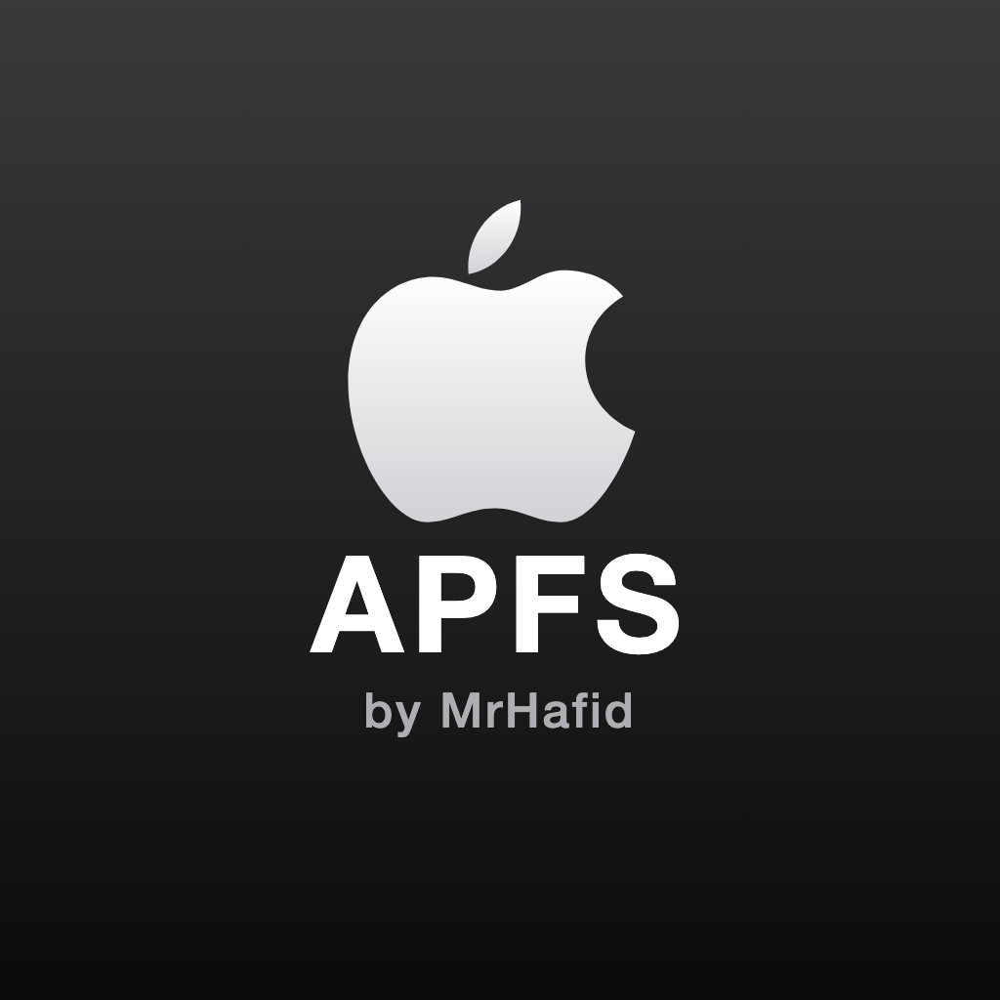
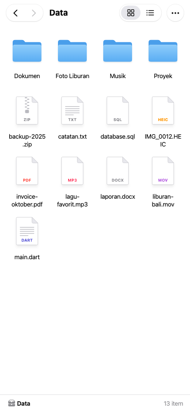
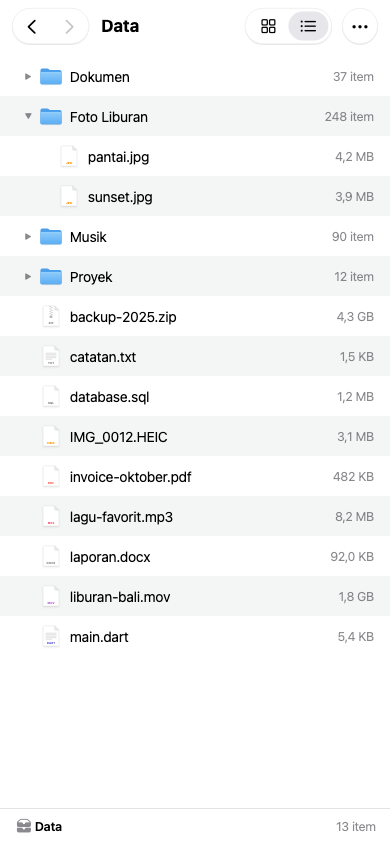
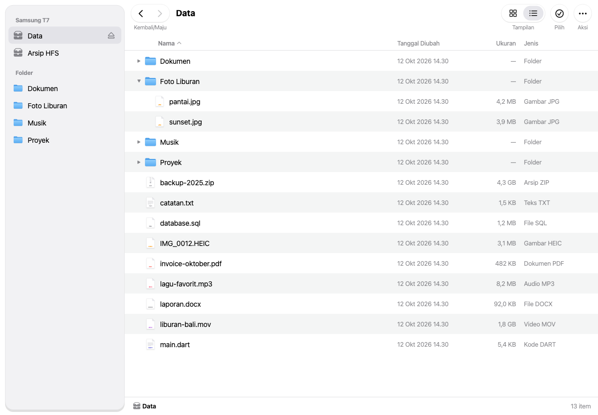

# APFS HFS Reader by MrHafid

<p align="center">
  
</p>

Aplikasi Android untuk membaca SSD atau flashdisk berformat **APFS**, **HFS+**, **exFAT**, dan **FAT32** lewat USB OTG. Aplikasi ini dibuat untuk penggunaan pribadi, dengan fokus pada privasi: data hanya dibaca, tidak pernah ditulis ke SSD, dan aplikasi tidak punya akses internet.

## Fitur

- Deteksi SSD otomatis saat dicolok lewat OTG
- Membaca volume **APFS** (termasuk case-sensitive), **HFS+**, **HFSX**, **exFAT**, dan **FAT12/16/32** (dengan nama panjang)
- Tabel partisi GPT, MBR (termasuk partisi logical), dan disk tanpa tabel partisi
- Partisi NTFS dan Linux ext dikenali namanya, tetapi belum bisa dibaca
- File explorer bergaya Finder macOS
  - Tampilan Ikon dan Daftar, dengan segitiga untuk membuka isi folder langsung di tempat
  - Kolom Nama, Tanggal Diubah, Ukuran, dan Jenis di layar lebar
  - Tombol kembali/maju, path bar, dan sidebar volume di tablet
  - Thumbnail foto dan video
  - Urutkan berdasarkan nama, tanggal, atau ukuran
  - Tekan lama untuk menu: Buka, Salin ke HP, Salin Nama, Info, Pilih
  - Mode pilih banyak item
- Preview foto, teks, dan PDF langsung di aplikasi
- Putar video dan audio langsung dari SSD, termasuk seek, tanpa server lokal
- Salin file atau folder ke HP lewat folder yang kamu pilih sendiri, dengan progres di latar belakang
- Tombol Eject untuk menutup semua akses sebelum SSD dicabut

## Tampilan

| HP — Ikon | HP — Daftar |
|---|---|
|  |  |



## Privasi

- APK release **tidak meminta izin internet**. Build release otomatis gagal kalau ada library yang menambahkan izin jaringan.
- Tidak ada analytics, crash reporting, iklan, atau SDK pihak ketiga yang mengirim data.
- Lapisan pembaca disk hanya bisa **membaca**. Tidak ada kode yang menulis ke SSD.
- Penyalinan ke HP memakai Storage Access Framework, tanpa izin penyimpanan yang luas.
- Cache preview dihapus saat SSD ditutup, dicabut, atau aplikasi dibuka ulang.

## Batasan

- Volume APFS terenkripsi (FileVault) belum didukung. Volume seperti ini terdeteksi dan diberi label.
- NTFS dan ext2/3/4 belum bisa dibaca.
- Saat SSD FAT32/exFAT dibuka di aplikasi ini, mount bawaan Android untuk disk itu dilepas sementara.
- File yang dikompresi macOS dengan LZFSE atau LZVN belum bisa dibuka. Kompresi zlib didukung.
- Bagian SSD di atas 2 TB tidak terbaca karena batas driver libaums (READ(10)).
- Snapshot APFS dan directory hard link HFS+ (Time Machine) tidak ditampilkan.

## Struktur Proyek

```
android/reader-core/   Parser APFS, HFS+, exFAT, FAT, GPT, MBR, dan decmpfs (Kotlin murni, di-test di JVM)
android/app/           Driver USB (libaums), Media3, salin via SAF, bridge Pigeon
lib/                   UI Flutter (Cupertino)
pigeons/               Definisi API Flutter ke Kotlin
tools/make_fixtures.sh Pembuat image disk APFS, HFS+, exFAT, dan FAT untuk test (macOS)
assets/branding/       Logo aplikasi
docs/superpowers/      Spec desain dan rencana implementasi
```

## Build dan Test

Kebutuhan: Flutter 3.47+, JDK 17+, Android SDK, dan macOS untuk membuat fixture test.

```bash
tools/make_fixtures.sh
cd android && ./gradlew :reader-core:test && cd ..
flutter test
flutter build apk --release
flutter install --release
```

Untuk membuka SSD berisi data asli, gunakan **build release**. Build debug memiliki izin internet karena dibutuhkan Flutter untuk hot reload.

## Hak Cipta

Copyright © 2026 **Achmad Hafid Supriyadi** — [mrhafid.com](https://mrhafid.com)

Seluruh hak dilindungi. Apple, APFS, dan logo Apple adalah merek dagang Apple Inc. Proyek ini tidak berafiliasi dengan Apple Inc.
